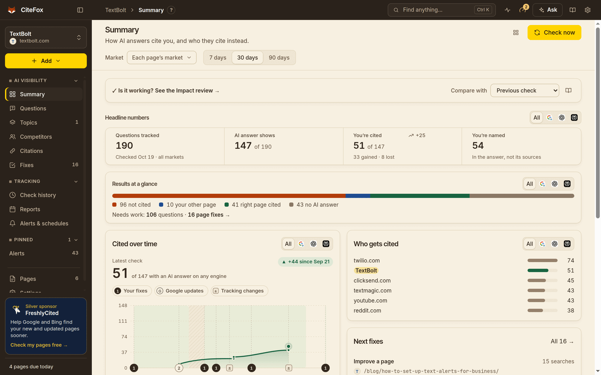

<h1 align="center">CiteFox: Free AI Visibility Tracker for Google AI Overviews, ChatGPT &amp; Perplexity (GEO / AEO)</h1>

<div align="center">

**See whether AI answers cite your website, which page they cite, who they cite instead, and what to fix. A free desktop app for Mac, Windows and Linux.**

[![Latest release][badge-version]][latest]
[![Total downloads][badge-downloads]][releases]
[![License: source-available][badge-license]](LICENSE)
[![Platforms: macOS, Windows, Linux][badge-platforms]](#download--install)

[![Download for macOS][button-mac]][site]
[![Download for Windows][button-win]][site]
[![Download for Linux][button-linux]][site]



[Website][site] · [Docs][docs] · [GEO glossary][glossary] · [FAQ](#faq) · [Releases][releases]

</div>

## What is CiteFox?

CiteFox is a free **AI visibility tracker**: a desktop app that tracks whether **Google AI Overviews, Google AI Mode, ChatGPT, Perplexity, Gemini and Copilot** cite your website for the questions your buyers ask.

When someone asks an AI engine a question, the answer often lists a few sources. CiteFox tells you if your pages are among them, which page was cited (and whether it is the page you want cited), which sites are cited instead, and what to change so you are cited more. Then it re-checks on a schedule and shows whether your changes worked.

It is a tool for **GEO (generative engine optimization)**, **AEO (answer engine optimization)** and **LLM SEO**: AI search visibility and AI citation tracking in one place, with client-ready reports.

## Features

### AI visibility tracking across six engines

See how often AI answers cite your website, by engine, country and language. A trend line marks every fix you made, and every number opens the exact questions it counts. Re-checks run on a schedule, even while the app is closed, within a monthly budget you set.


### Every AI answer and every cited source

Open any buyer question to read the full answer, the sources it links and how it changed between checks. For every answer, CiteFox records whether the **right page** was cited, **another page of yours**, your brand **named without a link**, or **someone else**. Buyer questions are written for you from your site, in the wording of each market.


### Competitor citation tracking

Find out who AI answers cite instead of you, on which questions and engines, and where a competitor wins and you do not. See every cited domain: competitors, review sites, forums and videos.


### Fix briefs and before-and-after tracking

Get a short brief for each page to improve or write. Log the change, and CiteFox measures the questions it should help for 14 days, then says whether it **worked**, made **no change** or **got worse**.


### Client-ready AI visibility reports

Six reports, rebuilt after every check. Read them in the app, download offline HTML, PDF or CSV, put your agency name and logo on them, or email them to clients on a schedule.


### Also included

- Topics and target pages: say which page should win each question
- Alerts on the desktop, by email or in Slack when a target page loses its citation or a competitor is cited instead
- **Ask CiteFox**: plain-English answers about your stored results, with links to the rows they count
- Import questions, pages and competitors from a sitemap, CSV or Excel file
- Many projects, each with its own markets and settings
- Light and dark themes

## Who it's for

- **SEO and GEO agencies**: track AI citations for every client, pitch new clients with an audit, and send branded reports on a schedule.
- **In-house marketers**: show whether AI answers recommend you or a competitor, and prove which page changes moved the numbers.
- **SaaS and ecommerce teams**: see which product, category and comparison pages AI engines cite for the questions buyers ask before they buy.

## How it works

1. **Add your website.** CiteFox AI reads your site and works out what you sell, who buys it and who your competitors are.
2. **Get your buyer questions.** It writes the questions your buyers really ask, grouped into topics, for each country and language you sell in.
3. **Check, fix, re-check.** It asks every AI engine, saves each answer and source, shows who is cited instead, writes fix briefs and re-checks on a schedule.


[Watch the demo video](media/demo.mp4) · [Getting started guide][doc-getting-started]

## Reports

| Report                                      | What it answers                                                  |
| ------------------------------------------- | ---------------------------------------------------------------- |
| [Visibility report][doc-reports-visibility] | Where you stand at one check, and who wins instead               |
| [What changed][doc-reports-changed]         | Any two checks compared, verdict first                           |
| [Impact review][doc-reports-impact]         | What your published pages and fixes did, before and after        |
| [Pitch / audit][doc-reports-pitch]          | A short audit from one check, to win a client or brief your boss |
| [Content plan][doc-reports-content]         | The pages to write or fix first, ready for a writer              |
| [Head-to-head][doc-reports-rival]           | You against one competitor: where they get cited and you do not  |

Every number in a report opens the list behind it, and the downloaded file shows the same numbers as the app. [Report branding][doc-reports-branding] puts your agency's or company's name and logo on every report.


## Supported AI engines

| Engine              | What CiteFox records                                                              |
| ------------------- | --------------------------------------------------------------------------------- |
| Google AI Overviews | Whether an AI Overview shows for the question, its text and every source it links |
| Google AI Mode      | Google's full AI search answer and the sources it cites                           |
| ChatGPT             | ChatGPT answers to your buyer questions and the web sources they cite             |
| Perplexity          | Perplexity answers and their numbered sources                                     |
| Gemini              | Gemini answers and the pages they cite                                            |
| Copilot             | Microsoft Copilot answers and the pages they cite                                 |

Each question is asked in every market you choose (a country and language pair, such as United States · English), because AI answers differ by place and language.

## GEO vs SEO: why AI citations matter

- **SEO** works to rank a page in the list of search results. **GEO** (generative engine optimization) and **AEO** (answer engine optimization) work to get a page cited as a source, or a brand named, inside an AI-written answer.
- AI answers appear above the links or replace them. A page can rank well and still not be cited, and AI engines also cite pages that do not rank at the top.
- Each engine picks its own sources, and answers change by country, language and over time. So citations have to be measured per engine and market, and checked again after every change.
- CiteFox does that measuring: which questions cite you, which page, who is cited instead, and whether your fixes changed it.

More terms in the [GEO and AEO glossary][glossary].

## Privacy

- **Your data stays on your computer.** Projects, questions, AI answers and reports are kept in the CiteFox data folder (on a Mac, `~/Library/Application Support/CiteFox`; on Windows, `%APPDATA%\CiteFox`; on Linux, `~/.config/CiteFox`).
- **Your keys stay in your system keychain**: the macOS Keychain, Windows Credential Manager, or the Secret Service on Linux. Settings and databases keep only a reference to the keychain item. Logs redact keys, passwords and prompt text.
- **What leaves your computer:** CiteFox talks to the services you connect, the pages and sitemaps you ask it to read, and GitHub Releases to tell you about a new version. It sends its maker, Space-O Technologies, just two things: the details you give in the **Join CiteFox** step, and an anonymous daily version ping. Details in [Docs/PRIVACY.md](Docs/PRIVACY.md).

## Download & install

Get CiteFox from the **[download page][site]**, which picks the right file for your computer, or from [GitHub Releases][releases].

| System             | File                                                                                    |
| ------------------ | --------------------------------------------------------------------------------------- |
| macOS (any Mac)    | `CiteFox-<version>-mac-universal.dmg`                                                   |
| macOS (Apple chip) | `CiteFox-<version>-mac-arm64.dmg` (smaller)                                             |
| macOS (Intel)      | `CiteFox-<version>-mac-x64.dmg` (smaller)                                               |
| Windows            | `CiteFox-<version>-win-x64.exe` installer (or `-arm64.exe`), or `-win-x64-portable.exe` |
| Linux              | `CiteFox-<version>-linux-x86_64.AppImage`, or `CiteFox-<version>-linux-amd64.deb`       |

**Builds are not code-signed yet**, so your computer asks once the first time you open CiteFox:

- **macOS:** open the `.dmg` and drag CiteFox to Applications. Open it; when macOS says it cannot check the app, click **Done**. Then open **System Settings › Privacy & Security**, scroll down and click **Open Anyway**. On macOS 14 or older you can instead Control-click the app and choose **Open**.
- **Windows:** run the installer. If you see "Windows protected your PC", click **More info**, then **Run anyway**. It installs for you only (no admin needed).
- **Linux:** make the AppImage executable (`chmod +x CiteFox-*.AppImage`) and open it, or install the deb with `sudo apt install ./CiteFox-*.deb`. Storing keys needs a Secret Service (GNOME Keyring or KWallet; the deb pulls in `libsecret-1-0`).

Every release has a `SHA256SUMS.txt` to check your download. CiteFox tells you when a new version is out; install it over the old one and your data is kept.

**What you need for the first check:** a key for a search data service (setup links to sign-up pages with free plans and tests the key before saving it), and an AI assistant for CiteFox AI: one you already use on your computer under your own plan, or a paste-in mode with your own ChatGPT. Setup walks you through both, and CiteFox shows what each check will use before it runs. See the [getting started guide][doc-getting-started].

## FAQ

### What is CiteFox?

CiteFox is a free desktop app for Mac, Windows and Linux that tracks whether Google AI Overviews, Google AI Mode, ChatGPT, Perplexity, Gemini and Copilot cite your website for the questions your buyers ask. It shows which page is cited, who is cited instead, what to fix, and whether your fixes worked.

### Is CiteFox free?

Yes. The app is free to download and use. Checks use search credits from your own account with a search data service; free plans are enough to try it. CiteFox shows what a check will use before it runs and stops at a monthly budget you set.

### How do I check if Google AI Overviews cite my website?

Add your website in CiteFox and run a check. It asks Google each buyer question in the markets you pick, records whether an AI Overview appeared, and lists every source it cited, with your pages marked. Re-checks show what changed over time.

### Can CiteFox track ChatGPT and Perplexity citations?

Yes. CiteFox asks ChatGPT, Perplexity, Gemini, Copilot and Google AI Mode the same questions as Google, and shows for each engine whether your site was cited, named without a link, or missing.

### What is the difference between GEO, AEO and SEO?

SEO aims to rank pages in search results. GEO (generative engine optimization) and AEO (answer engine optimization) aim to get your pages cited, and your brand named, inside AI-written answers such as Google AI Overviews and ChatGPT. LLM SEO is another name for the same work.

### Does CiteFox send my data to a server?

Your projects, questions, AI answers and reports stay on your computer, and your keys stay in your system keychain. CiteFox talks only to the services you connect and the pages you ask it to read. It sends its maker, Space-O Technologies, just two things: the details you give in the Join step, and an anonymous daily version ping.

### Is CiteFox open source?

CiteFox is source-available, not open source. The full code is public on GitHub: you can read it, run it, change it for your own use and send improvements. Copies you share must keep the CiteFox name and sponsors. See [LICENSE](LICENSE).

### Can agencies use CiteFox for client reports?

Yes. The license allows use for your company's clients. CiteFox has six ready reports (Visibility, What changed, Impact review, Pitch / audit, Content plan and Head-to-head) that you can brand with your agency name and logo, download as offline HTML, PDF or CSV, or email on a schedule.

### What do I need to run CiteFox?

A Mac, Windows or Linux computer, a key for a search data service (CiteFox links to sign-up pages with free plans and tests the key), and an AI assistant for CiteFox AI: one you already use on your computer under your own plan, or a paste-in mode with your own ChatGPT.

### Why does my computer warn me when I open CiteFox?

CiteFox builds are not code-signed with a paid certificate yet, so macOS and Windows ask once before the first start. On a Mac, click **Open Anyway** in **System Settings › Privacy & Security**. On Windows, choose **More info**, then **Run anyway**. Every release lists a SHA-256 checksum for each file.

### Which countries and languages does CiteFox support?

You pick the markets: a country and language pair, such as United States · English or Germany · German. CiteFox writes the buyer questions in each market's wording and checks each market separately, because AI answers differ by place and language.

## What makes CiteFox different

- **A desktop app.** Your projects, answers and reports stay on your computer, not in someone else's cloud.
- **Free.** Checks run on your own keys, and CiteFox shows the cost before every check.
- **Source-available.** Anyone can read the code and see exactly what it does.
- **Page-level answers.** Which of your pages is cited, and whether it is the page you want cited.
- **A full loop.** Buyer questions, checks, fix briefs, 14-day verdicts and client reports in one tool.

## Roadmap

Planned next, in no fixed order (plans, not promises). Follow [Releases][releases] and the [changelog](CHANGELOG.md) for what has shipped.

- Signed and notarized builds for macOS and Windows, so the first-start warning goes away
- Automatic updates inside the app
- More report sections and downloads, matched to what agencies send their clients
- Better first-run setup: reading a sitemap during setup, and clearer help on every screen

Ideas are welcome in [Issues][issues].

## Contributing

Issues, ideas and pull requests are welcome. Read [CONTRIBUTING.md](CONTRIBUTING.md) for the code layout, tests and the pull request checklist, and [CODE_OF_CONDUCT.md](CODE_OF_CONDUCT.md). Security problems go to [SECURITY.md](SECURITY.md), not to Issues. For help using CiteFox, see [SUPPORT.md](SUPPORT.md).

## Build from source

You need **Node.js 24.19 or newer** (`nvm use` reads `.nvmrc`).

```bash
npm ci
sh scripts/try.sh     # opens CiteFox with live reload, on its own "CiteFox Dev" data folder
```

`npm run dev` does the same with the default data folder. `npm run build` compiles the app, `npm run dist` builds installers for your computer, and `npm run test:unit` runs the tests (they are offline and need no keys). Setup in a source build is the same as in an installed one; [Docs/AI-PROVIDERS.md](Docs/AI-PROVIDERS.md) explains how the AI connections are used and locked down.

[CONTRIBUTING.md](CONTRIBUTING.md) has every script, the e2e suite in Docker, running a second copy, testing installed builds, packaging and the code layout. Releases are described in [Docs/RELEASING.md](Docs/RELEASING.md). The public site in `site/` is built by `npm run site:build` from `Docs/help/` (see [Docs/PUBLISHING.md](Docs/PUBLISHING.md)).

### Terms of the services you connect

CiteFox runs on your own computer, and you are responsible for the terms of the services you connect. An AI assistant signed in under your personal plan is for your own use; client projects, shared computers and work on behalf of someone else need an API key. Extra search keys must be ones you are entitled to use: your own plan or a client's. [Docs/AI-PROVIDERS.md](Docs/AI-PROVIDERS.md) links to each service's terms.

## Sponsors

CiteFox is free and source-available. Sponsors pay for its development.

- **Gold: [FoxCue](https://foxcue.com/)**. Get cited in AI answers, with you on camera. FoxCue turns your pages into videos AI Overviews cite.
- **Silver: [FreshlyCited](https://freshlycited.com/)**. Help Google and Bing find your new and updated pages sooner.

In the app, the gold sponsor has a card at the end of every screen and the silver sponsor a small card at the foot of the sidebar. CiteFox sends sponsors nothing: links carry only `utm_source=citefox&utm_medium=app&utm_campaign=sponsor`, and logos are bundled. See [SPONSORS.md](SPONSORS.md), including a request to forks and how to become a sponsor.

## License

CiteFox is **source-available** under the [CiteFox Source-Available License](LICENSE), © 2026 Space-O Technologies. You may use it for yourself and your company, including for your company's clients, read and change the code, and share copies free of charge that keep the CiteFox name, sponsors and license. It is not open source under the OSI definition. See [LICENSE](LICENSE), [NOTICE](NOTICE) and [TRADEMARKS.md](TRADEMARKS.md).

Bundled fonts (Noto, Inter, Inter Tight, JetBrains Mono) are under the SIL Open Font License (`resources/fonts/OFL.txt`, `src/renderer/src/assets/fonts/OFL-*.txt`). The citation sound is CiteFox's own, synthesised by `scripts/sounds/make_jingles.py`. Sponsor names and logos, and the AI engines' names and logos, are trademarks of their owners.

## Contact

Questions, ideas or sponsorship: **getcitifox@gmail.com**. Bugs and feature requests: [GitHub Issues][issues]. Questions and show-and-tell: [GitHub Discussions][discussions]. CiteFox is made by [Space-O Technologies](https://www.spaceo.ca).

<!-- Links. The public repository (spcaeo/citefox) and the site address live only here;
     change them in this block (and in scripts/site/config.mjs) if either moves. -->

[site]: https://spcaeo.github.io/citefox/
[docs]: https://spcaeo.github.io/citefox/docs/
[glossary]: https://spcaeo.github.io/citefox/glossary/
[doc-getting-started]: https://spcaeo.github.io/citefox/docs/getting-started/
[doc-reports-branding]: https://spcaeo.github.io/citefox/docs/reports-branding/
[doc-reports-changed]: https://spcaeo.github.io/citefox/docs/reports-changed/
[doc-reports-content]: https://spcaeo.github.io/citefox/docs/reports-content/
[doc-reports-impact]: https://spcaeo.github.io/citefox/docs/reports-impact/
[doc-reports-pitch]: https://spcaeo.github.io/citefox/docs/reports-pitch/
[doc-reports-rival]: https://spcaeo.github.io/citefox/docs/reports-rival/
[doc-reports-visibility]: https://spcaeo.github.io/citefox/docs/reports-visibility/
[latest]: https://github.com/spcaeo/citefox/releases/latest
[releases]: https://github.com/spcaeo/citefox/releases
[issues]: https://github.com/spcaeo/citefox/issues
[discussions]: https://github.com/spcaeo/citefox/discussions
[badge-version]: https://img.shields.io/github/v/release/spcaeo/citefox?label=version&color=b23c0a
[badge-downloads]: https://img.shields.io/github/downloads/spcaeo/citefox/total?color=2a221b
[badge-license]: https://img.shields.io/badge/license-source--available-6f2a10
[badge-platforms]: https://img.shields.io/badge/platforms-macOS%20%7C%20Windows%20%7C%20Linux-4f3f31
[button-mac]: https://img.shields.io/badge/Download-macOS-111111?style=for-the-badge&logo=apple
[button-win]: https://img.shields.io/badge/Download-Windows-0b5cad?style=for-the-badge
[button-linux]: https://img.shields.io/badge/Download-Linux-b23c0a?style=for-the-badge&logo=linux&logoColor=white
