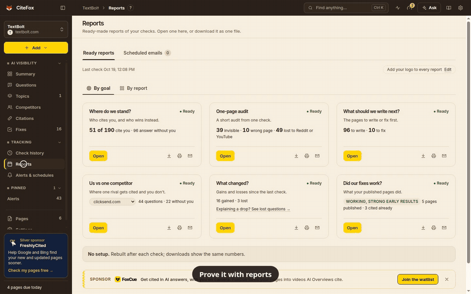
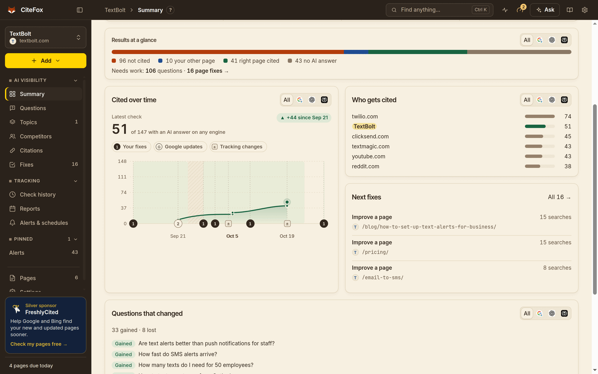
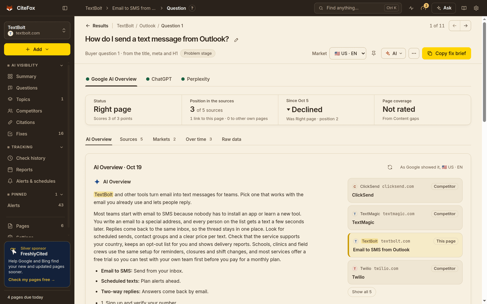
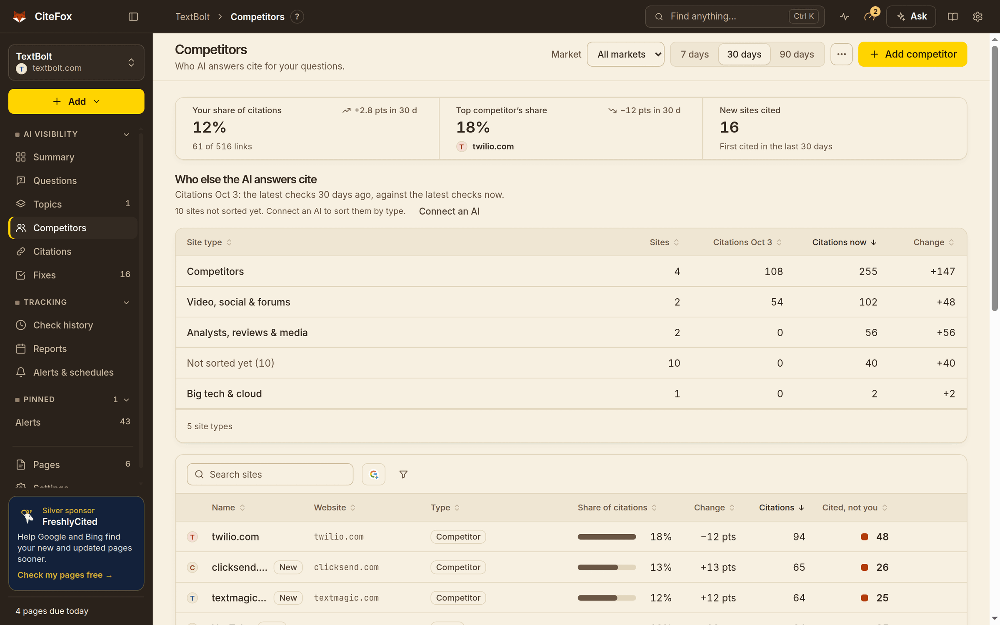
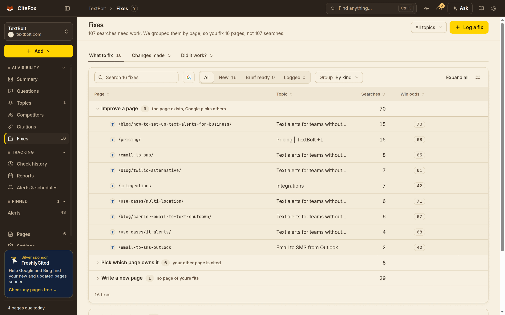
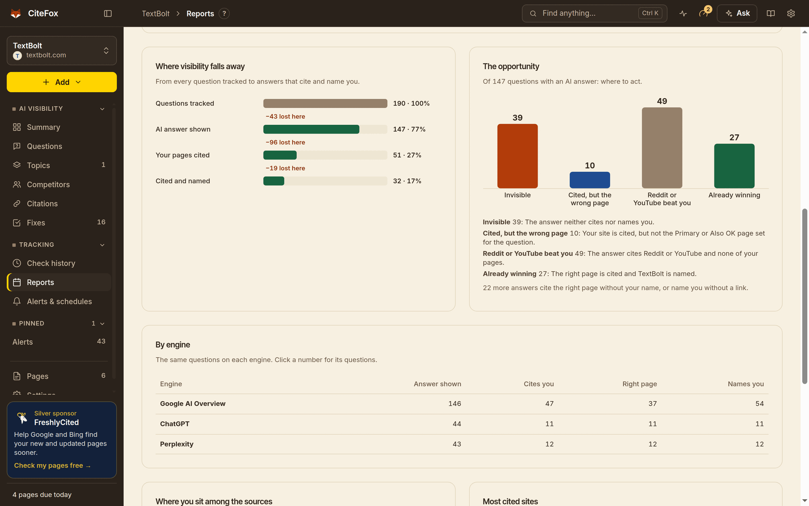
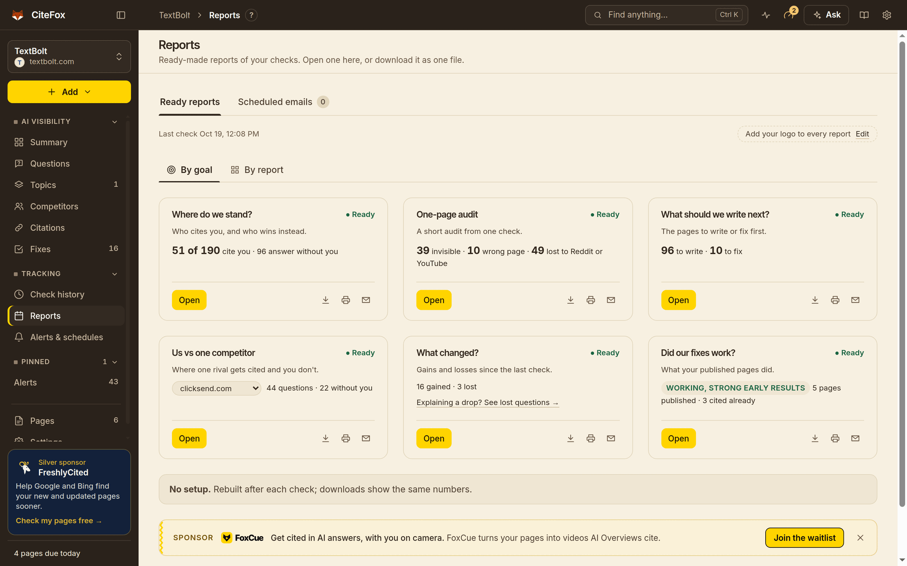

<h1 align="center">CiteFox: Free AI Visibility Tracker for Google AI Overviews, ChatGPT &amp; Perplexity (GEO / AEO)</h1>

<div align="center">

**See whether AI answers cite your website, which page they cite, who they cite instead, and what to fix.**<br>
**A free desktop app for Mac, Windows and Linux. Your keys, your data, your computer.**

[![Latest release][badge-version]][latest]
[![Total downloads][badge-downloads]][releases]
[![License: source-available][badge-license]](https://github.com/spcaeo/citefox/blob/main/LICENSE)
[![Platforms: macOS, Windows, Linux][badge-platforms]](#download-and-install)
[![GitHub stars][badge-stars]][stargazers]

[![Download for macOS][button-mac]][site]
[![Download for Windows][button-win]][site]
[![Download for Linux][button-linux]][site]

<a href="https://github.com/spcaeo/citefox/blob/main/media/demo.mp4"></a>

[▶ Watch the 75-second video with sound](https://github.com/spcaeo/citefox/blob/main/media/demo.mp4)

**[Try the live demo][demo]** (in your browser, sample data) · [Sample reports][samples]

[Website][site] · [Live demo][demo] · [Sample reports][samples] · [Docs][docs] · [Compare](#how-citefox-compares) · [FAQ](#faq) · [Releases][releases]

⭐ Star this repo to get new releases in your GitHub feed.

</div>

> **A free, local alternative to Profound, Peec AI, Otterly.AI and Semrush's AI toolkit.**
>
> **In short.** CiteFox is free. You connect your own pay-as-you-go accounts, so you pay the data
> services directly, a few cents per question, and CiteFox shows the cost first.
> Everything it collects stays on your computer. A self-hosted server edition, a managed
> service and an MCP server are coming soon.

## Contents

- [Bring your own API keys](#bring-your-own-api-keys)
- [Local and private: your data stays on your computer](#local-and-private-your-data-stays-on-your-computer)
- [Editions: Desktop today, Server and managed service coming soon](#editions-desktop-today-server-and-managed-service-coming-soon)
- [Why full control matters](#why-full-control-matters)
- [Why teams pick CiteFox](#why-teams-pick-citefox)
- [AI visibility tracking features](#ai-visibility-tracking-features)
- [Client-ready AI visibility reports](#client-ready-ai-visibility-reports)
- [How it works](#how-it-works) · [Supported AI engines](#supported-ai-engines) · [Who it's for](#who-its-for)
- [Real answers, not guessed prompt volume](#real-answers-not-guessed-prompt-volume)
- [How CiteFox compares](#how-citefox-compares) with Profound, Peec AI, Otterly.AI and others
- [Download and install](#download-and-install) · [FAQ](#faq) · [Community and contributing](#community-and-contributing)
- [Help docs](https://github.com/spcaeo/citefox/blob/main/Docs/HELP.md) · [Build from source](#build-from-source) · [Sponsors](#sponsors) · [License](#license) · [About us](#about-us)

## Bring your own API keys

CiteFox is free. To capture data it uses third-party services through **your own accounts**, so you
pay them directly, only for what you use, and nobody marks it up.

**Already pay for Claude Code or Codex?** CiteFox uses that plan for all its AI work (reading your
site, writing questions, fix briefs), so there is no extra AI cost. The only pay-as-you-go part is
the search data service that captures the AI answers: a few cents per question.

**Only have a desktop app for Claude Code or Codex?** CiteFox finds the Claude Code that the desktop
app keeps inside it (open its Code tab once and sign in), so no Terminal is needed. The Codex desktop
app cannot be used by other programs: install the free Codex command-line tool instead, or use an AI
model API key.

| What you connect                              | What CiteFox uses it for                                                                                 | How you pay                                                                                                                                                                                 |
| --------------------------------------------- | -------------------------------------------------------------------------------------------------------- | ------------------------------------------------------------------------------------------------------------------------------------------------------------------------------------------- |
| **A search data API**                         | Asks each AI engine your buyer questions and saves every answer and source                               | Pay-as-you-go credits. Free tiers are enough to try it.                                                                                                                                     |
| **Claude Code or Codex** (or an AI model API) | Reads your site, writes buyer questions, finds competitors, writes fix briefs and answers your questions | Runs on the Claude Code or Codex plan you already pay for, so **no extra AI cost**. Or use a pay-as-you-go AI model API key. During setup you can even paste prompts into your own ChatGPT. |

- **You see the cost first.** Before every check CiteFox shows how many credits it will use and how
  many are left. Setup and Settings show the price in US dollars per check and per month, history
  shows what each check cost, and checks stop at a monthly budget you set.
- **What a check costs.** At the list price of the default search plan, one question on one engine
  costs well under one US cent. Ten buyer questions on all six engines come to about 30 cents. Your
  price depends on your plan, and the app always shows the real number.
- **Setup walks you through it.** It links to each sign-up page and tests every key before saving it.
  Keys are stored in your operating system's keychain.

The exact services and their terms are listed under [Build from source](#services-you-connect).

## Local and private: your data stays on your computer

- **Everything is stored on your computer**, in a local database (SQLite) in the CiteFox data folder.
- **There is no CiteFox cloud.** Your projects, SEO data, buyer questions, AI answers, reports and
  keys never go to a CiteFox server.
- **Keys live in the OS keychain**: the macOS Keychain, Windows Credential Manager, or the Secret
  Service on Linux. Logs redact keys, passwords and prompt text.
- **What leaves your computer:** calls to the services you connect, the pages and sitemaps you ask
  CiteFox to read, and a check for new versions on GitHub. CiteFox itself receives only the details you
  type in the optional **Join CiteFox** step and an anonymous daily version ping.

<details>
<summary>Where the data folder is, and the full privacy details</summary>

- macOS: `~/Library/Application Support/CiteFox`
- Windows: `%APPDATA%\CiteFox`
- Linux: `~/.config/CiteFox`

Settings and databases keep only a reference to each keychain item, never the key itself. Every
message CiteFox sends, and how to have it deleted, is in [Docs/PRIVACY.md](https://github.com/spcaeo/citefox/blob/main/Docs/PRIVACY.md).

</details>

## Editions: Desktop today, Server and managed service coming soon

| Edition                    | Status                  | For                                                                                                                        |
| -------------------------- | ----------------------- | -------------------------------------------------------------------------------------------------------------------------- |
| **Desktop**                | **Free, available now** | Anyone. Runs on your Mac, Windows or Linux computer. Everything stays on that computer.                                    |
| **Server** (self-hosted)   | Coming soon             | Teams and agencies who want to run CiteFox on their own server and share it, with the data still on hardware they control. |
| **Subscription** (managed) | Coming soon             | Teams who want it done for them: we run the checks and do the optimization work as a service.                              |
| **MCP server**             | Coming soon             | AI assistants and agents that query your CiteFox data, with the data still on your side.                                   |

**Want early access to Server, the managed service or the MCP server?** Email
[getcitifox@gmail.com](mailto:getcitifox@gmail.com?subject=CiteFox%20early%20access) and say which one.

<details>
<summary>Also planned for the desktop app (plans, not promises)</summary>

- Signed and notarized builds for macOS and Windows, so the first-start warning goes away
- Automatic updates inside the app
- More report sections and downloads, matched to what agencies send their clients
- Better first-run setup: reading a sitemap during setup, and clearer help on every screen

Follow [Releases][releases] and the [changelog](https://github.com/spcaeo/citefox/blob/main/CHANGELOG.md) for what has shipped. Ideas are welcome
in [Discussions][discussions].

</details>

**Let an AI agent run it for you.** CiteFox runs on Linux, so you can try installing it on an AI
agent's own Linux computer, such as Grok Bot, Meta Muse or OpenAI dots, and have the agent run your
checks and reports on a schedule. The MCP server (coming soon) will make this smoother.

## Why full control matters

- **Your data.** Results stay on your computer. Nothing to migrate out of, nothing held hostage.
- **Your keys, your costs.** You pay the data services directly, at their prices, with a budget cap.
- **No per-seat SaaS fees.** The app is free, however many projects or clients you track.
- **No vendor lock-in.** Export everything as offline HTML, PDF or CSV.
- **Source-available.** Read the code and see exactly what each number means and where it comes from.
- **Works offline after checks.** Results and reports open without the internet; only new checks and
  AI help need it.
- **Client data stays out of other clouds.** For agencies, client sites, questions and results never sit
  in a third-party dashboard.

## Why teams pick CiteFox

|                                         |                                                                                                                                                                   |
| --------------------------------------- | ----------------------------------------------------------------------------------------------------------------------------------------------------------------- |
| **Free and local**                      | A free desktop app. Your data on your computer, your own keys, the cost shown before every check.                                                                 |
| **The right page, not just the domain** | Set the page that should be cited for each question. CiteFox tells you if that page, another page of yours, your brand without a link, or someone else was cited. |
| **Fixes with a verdict**                | Log a change and CiteFox re-checks for 14 days, then says whether it **worked**, made **no change** or **got worse**.                                             |
| **Six client-ready reports**            | Visibility, What changed, Impact review, Pitch / audit, Content plan and Head-to-head, rebuilt after every check.                                                 |
| **Branded for agencies**                | Your agency's name and logo with "Prepared for" each client, or your company's, or none.                                                                          |
| **Every number drills down**            | Click any number, in the app or a report, to see the exact questions and answers behind it.                                                                       |

## AI visibility tracking features

### Track AI citations across six engines

See how often AI answers cite your website, by engine, country and language. A trend line marks every
fix you made, and every number opens the exact questions it counts. Re-checks run on a schedule, even
while the app is closed, within a monthly budget you set.



### Read every AI answer and every cited source

Open any buyer question to read the full answer, the sources it links and how it changed between checks.
Buyer questions are written for you from your site, in the wording of each market.



### See which competitors AI answers cite instead of you

Find out who AI answers cite instead of you, on which questions and engines, and where a competitor wins
and you do not. See every cited domain: competitors, review sites, Reddit, YouTube and other communities.



### Fix briefs and before-and-after tracking

Get a short brief for each page to improve or write. Log the change, and CiteFox measures the questions it
should help for 14 days, then gives its verdict.



<details>
<summary>Also included</summary>

- Topics and target pages: say which page should win each question (a Primary page and Also OK pages)
- Alerts on the desktop, by email or in Slack when a target page loses its citation or a competitor is cited instead
- **Ask CiteFox**: plain-English answers about your stored results, with links to the rows they count
- Import questions, pages and competitors from a sitemap, CSV or Excel file
- Many projects, each with its own markets and settings
- Light and dark themes

</details>

## Client-ready AI visibility reports

Six reports, rebuilt after every check. Open the Reports home **By goal** ("Where do we stand?", "Did our
fixes work?") or **By report**. See them for yourself in the [sample reports][samples].

| Report                                      | What it answers                                                                                                   | Who it's for                          |
| ------------------------------------------- | ----------------------------------------------------------------------------------------------------------------- | ------------------------------------- |
| [Visibility report][doc-reports-visibility] | Where you stand: the opportunity, competitors and share of voice, sources, reputation and sentiment, answer shape | Monthly client or leadership updates  |
| [What changed][doc-reports-changed]         | Any two checks compared, verdict first: citations and brand named, then what moved up, down, in and out           | Check-ins after each re-check         |
| [Impact review][doc-reports-impact]         | Did our fixes work? Published pages before and after, a page-by-page story, and what the client needs to do       | Proving the value of the work         |
| [Pitch / audit][doc-reports-pitch]          | A one-page audit from a single check: the gap, who wins instead, and what we'd fix first                          | Winning a new client, briefing a boss |
| [Content plan][doc-reports-content]         | The pages to write or fix, by topic, each with a brief you can copy to a writer                                   | Writers and content leads             |
| [Head-to-head][doc-reports-rival]           | You against one competitor: where they are cited and you are not                                                  | Answering "why them and not us?"      |

- **Downloads:** offline HTML, PDF and CSV, with the same numbers as the app.
- **Scheduled emails:** send any report to clients on a schedule.
- **[Branding][doc-reports-branding]:** an agency (your name and logo, "Prepared for" each client), in-house
  (your company), or plain.
- **Every number drills down** to the questions behind it, across all six engines or one at a time.



## How it works

1. **Add your website.** CiteFox AI reads your site and works out what you sell, who buys it and who your competitors are.
2. **Get your buyer questions.** It writes the questions your buyers really ask, grouped into topics, for each country and language you sell in.
3. **Check, fix, re-check.** It asks every AI engine, saves each answer and source, shows who is cited instead, writes fix briefs and re-checks on a schedule.



[Try the live demo][demo] · [Watch the demo video](https://github.com/spcaeo/citefox/blob/main/media/demo.mp4) · [Getting started guide][doc-getting-started]

## Supported AI engines

| Engine              | What CiteFox records                                                              |
| ------------------- | --------------------------------------------------------------------------------- |
| Google AI Overviews | Whether an AI Overview shows for the question, its text and every source it links |
| Google AI Mode      | Google's full AI search answer and the sources it cites                           |
| ChatGPT             | ChatGPT answers to your buyer questions and the web sources they cite             |
| Perplexity          | Perplexity answers and their numbered sources                                     |
| Gemini              | Gemini answers and the pages they cite                                            |
| Copilot             | Microsoft Copilot answers and the pages they cite                                 |

Each question is asked in every market you choose (a country and language pair, such as United States ·
English), because AI answers differ by place and language.

## Who it's for

- **SEO and GEO agencies**: track AI citations for every client, pitch new clients with an audit, and send branded reports on a schedule.
- **In-house marketers**: show whether AI answers recommend you or a competitor, and prove which page changes moved the numbers.
- **SaaS and ecommerce teams**: see which product, category and comparison pages AI engines cite for the questions buyers ask before they buy.

<details>
<summary>GEO vs SEO: why AI citations matter</summary>

- **SEO** works to rank a page in the list of search results. **GEO** (generative engine optimization) and **AEO** (answer engine optimization) work to get a page cited as a source, or a brand named, inside an AI-written answer.
- AI answers appear above the links or replace them. A page can rank well and still not be cited, and AI engines also cite pages that do not rank at the top.
- Each engine picks its own sources, and answers change by country, language and over time. So citations have to be measured per engine and market, and checked again after every change.
- CiteFox does that measuring: which questions cite you, which page, who is cited instead, and whether your fixes changed it.

More terms in the [GEO and AEO glossary][glossary].

</details>

## Real answers, not guessed "prompt volume"

**Nobody has real prompt volume data.** ChatGPT, Perplexity and Gemini don't publish how often a question is asked, so every "prompt volume" figure on the market is a modelled estimate built from panels and clickstream data ([Ahrefs](https://ahrefs.com/blog/how-ahrefs-estimates-ai-search-demand/) notes that, apart from Microsoft Copilot, no major AI platform shares its query data).

**Chat assistants answer each person differently.** ChatGPT can use your saved memories and past chats to tailor its replies ([OpenAI help](https://help.openai.com/en/articles/8590148)), and other assistants now remember earlier conversations too. So one person's answer can differ from the next person's.

**Google's AI Overviews are the steadier signal.** They have no personal chat memory, and Google aims to keep results mostly the same for everyone. Their wording stays close from day to day, while the cited sources do rotate ([Ahrefs](https://ahrefs.com/blog/ai-overview-change/) measured about 0.95 meaning similarity between checks, but only ~55% of cited links in common). That is why CiteFox treats Google AI Overviews as the anchor, checks the other engines beside it, and re-checks on a schedule instead of trusting one snapshot.

**So CiteFox is built on three foundations:**

1. **Your real buyer questions, in the three ways people ask:** a **short search** as typed into Google, a natural **question**, and a longer **situation** ("We're a 20-person clinic and our SMS reminders stopped…"). Never with your brand name in them, so they show whether AI finds you on its own.
2. **Real answers, checked again and again:** every check stores the full AI answer and every source, so you see trends, not one lucky or unlucky answer.
3. **The right page for each question:** a Primary page (plus Also OK pages), so "cited" means the page you want, and fixes can be measured before and after.

## How CiteFox compares

Facts about other tools come from each vendor's own website, pricing page and docs, checked on 2026-11-02. The full matrix, with a source for every cell and three more tools (Rankscale, Goodie AI and Similarweb), is in **[Docs/COMPARISON.md](https://github.com/spcaeo/citefox/blob/main/Docs/COMPARISON.md)**.

✓ yes · ◐ partly, as an add-on or on some plans · ✗ no, or not found in its docs · ? not confirmed on the vendor's pages

|                                          |      **CiteFox**      |  Profound   | Peec AI | Otterly.AI |   Scrunch   | AthenaHQ  |  Searchable  | Promptwatch | Semrush AI ¹ | Ahrefs Brand Radar |
| ---------------------------------------- | :-------------------: | :---------: | :-----: | :--------: | :---------: | :-------: | :----------: | :---------: | :----------: | :----------------: |
| **Pricing & control**                    |                       |             |         |            |             |           |              |             |              |                    |
| How it runs                              |      Desktop app      |    SaaS     |  SaaS   |    SaaS    |    SaaS     |   SaaS    |     SaaS     |    SaaS     |     SaaS     |        SaaS        |
| Your data stays on your computer         |           ✓           |      ✗      |    ✗    |     ✗      |      ✗      |     ✗     |      ✗       |      ✗      |      ✗       |         ✗          |
| Hosted web dashboard                     |     Not needed ⁴      |      ✓      |    ✓    |     ✓      |      ✓      |     ✓     |      ✓       |      ✓      |      ✓       |         ✓          |
| Free plan or trial                       |       Free app        | 7-day trial |    ?    |   Trial    | 7-day trial | Free plan | 14-day trial |    Trial    |      ✗       |     ◐ checker      |
| Price to start                           |  Free; your own keys  |   Custom    |   $95   |    $29     |    $300     |   $295    |     $125     |     $95     |     $99      |   $199 add-on ²    |
| Licence                                  |   Source-available    |   Closed    | Closed  |   Closed   |   Closed    |  Closed   |    Closed    |   Closed    |    Closed    |       Closed       |
| **Engines**                              |                       |             |         |            |             |           |              |             |              |                    |
| Google AI Overviews                      |           ✓           |      ✓      |    ✓    |     ✓      |      ✓      |     ✓     |      ✓       |      ✓      |      ✓       |         ✓          |
| Google AI Mode                           |           ✓           |      ◐      |    ✓    |     ◐      |      ✓      |     ◐     |      ◐       |      ✓      |      ✓       |         ✓          |
| ChatGPT                                  |           ✓           |      ✓      |    ✓    |     ✓      |      ✓      |     ✓     |      ✓       |      ✓      |      ✓       |         ✓          |
| Perplexity                               |           ✓           |      ◐      |    ◐    |     ✓      |      ✓      |     ✓     |      ✓       |      ✓      |      ◐       |         ✓          |
| Gemini                                   |           ✓           |      ✓      |    ✓    |     ◐      |      ✓      |     ✓     |      ◐       |      ✓      |      ◐       |         ✓          |
| Copilot                                  |           ✓           |      ◐      |    ✓    |     ✓      |      ✗      |     ✓     |      ◐       |      ✓      |      ✗       |         ✓          |
| More engines than these six              | The six that matter ⁵ |      ◐      |    ◐    |     ◐      |      ✓      |     ◐     |      ◐       |      ✓      |      ✗       |         ◐          |
| **Analysis**                             |                       |             |         |            |             |           |              |             |              |                    |
| Your own prompts / buyer questions       |           ✓           |      ✓      |    ✓    |     ✓      |      ✓      |     ✓     |      ✓       |      ✓      |      ✓       |         ✓          |
| Topics or clusters                       |           ✓           |      ✓      |    ✓    |     ✓      |      ✓      |     ◐     |      ✓       |      ✓      |      ✓       |         ✓          |
| Right page cited check (target pages)    |           ✓           |      ◐      |    ◐    |     ?      |      ?      |     ?     |      ?       |      ?      |      ?       |         ?          |
| Countries and languages                  |           ✓           |      ◐      |    ✓    |     ✓      |      ?      |     ◐     |      ✓       |      ✓      |      ✓       |         ✓          |
| Prompt volume data                       | Your real questions ⁶ |      ✓      |    ✓    |     ?      |      ?      |     ◐     |      ?       |      ✓      |      ✓       |         ✓          |
| Competitor share of voice                |           ✓           |      ✓      |    ✓    |     ✓      |      ✓      |     ✓     |      ✓       |      ✓      |      ✓       |         ✓          |
| Source analysis (Reddit, YouTube)        |           ✓           |      ✓      |    ✓    |     ✓      |      ✓      |     ✓     |      ✓       |      ✓      |      ◐       |         ✓          |
| Sentiment                                |           ✓           |      ✓      |    ✓    |     ✓      |      ✓      |     ◐     |      ✓       |      ✓      |      ✓       |         ✓          |
| AI crawler / traffic analytics           |  With Skald, free ⁷   |      ✓      |    ✓    |     ◐      |      ✓      |     ?     |      ✓       |      ◐      |      ◐       |         ✓          |
| **Fixes**                                |                       |             |         |            |             |           |              |             |              |                    |
| Fix recommendations                      |           ✓           |      ✓      |    ✓    |     ✓      |      ✓      |     ✓     |      ✓       |      ◐      |      ✓       |         ?          |
| Fix tracking with a before/after verdict |           ✓           |      ◐      |    ◐    |     ?      |      ?      |     ?     |      ?       |      ?      |      ?       |         ?          |
| **Reports**                              |                       |             |         |            |             |           |              |             |              |                    |
| Client reports / white-label             |           ✓           |      ◐      |    ◐    |     ✓      |      ◐      |     ?     |      ◐       |      ✓      |      ◐       |         ◐          |
| Pitch audit for a prospect               |           ✓           |      ◐      |    ?    |     ◐      |      ?      |     ?     |      ?       |      ?      |      ?       |         ?          |
| Scheduled email reports                  |           ✓           |      ◐      |    ?    |     ?      |      ?      |     ?     |      ✓       |      ?      |      ?       |         ◐          |
| Export (CSV, PDF, HTML)                  |    HTML, PDF, CSV     |      ◐      |   CSV   |  CSV, PDF  | CSV, Excel  |   ◐ CSV   |   PDF, CSV   |      ◐      |     CSV      |         ◐          |
| **Integrations**                         |                       |             |         |            |             |           |              |             |              |                    |
| API                                      |  Your own database ⁸  |      ◐      |    ◐    |     ◐      |      ◐      |     ◐     |      ✓       |      ✓      |      ?       |         ?          |
| MCP server                               |     Coming soon ³     |      ✓      |    ✓    |     ◐      |      ◐      |     ✓     |      ✓       |      ✓      |      ?       |         ?          |

¹ Semrush's AI Visibility Toolkit. ² Ahrefs Brand Radar is an add-on to a paid Ahrefs plan; custom prompts alone start at $50 a month. Pitch audit: Profound's Agency Mode and Otterly.AI's agency plans have pitch workspaces; CiteFox has a ready Pitch / audit report. ³ A CiteFox MCP server is planned, not shipped. Prices are monthly list prices in USD on 2026-11-02 and change often.
⁴ CiteFox runs on your computer, so there are no logins to share and no per-seat fees; share results as reports and scheduled emails. A self-hosted server edition for teams is coming soon.
⁵ Google AI Overviews, AI Mode, ChatGPT, Perplexity, Gemini and Copilot: where buyers ask today.
⁶ No AI platform except Copilot publishes query volumes, so every "prompt volume" is an estimate. CiteFox checks real AI answers to your buyer questions instead ([why](https://github.com/spcaeo/citefox#real-answers-not-guessed-prompt-volume)).
⁷ For AI crawlers and AI traffic, pair CiteFox with [Skald](https://github.com/spcaeo/skald): our free analytics that runs on your own server and reads its access log. It names GPTBot, PerplexityBot, ChatGPT-User and the rest, checks each crawler is real, splits AI visits by why they came (training, answering someone live, or a person clicking a citation), and shows the leads AI sent.
⁸ Every result is in a local database file you own and can query or back up; an MCP server for AI agents is coming soon.

### Where others go further, and why CiteFox is built differently

- **Hosted dashboards.** The others run in a browser with shared logins. CiteFox keeps everything on your computer instead: no seat fees, no client data in someone else's cloud, and branded reports to share. A self-hosted server edition is coming soon for teams that want one shared place.
- **More engines.** Some enterprise plans add Grok, DeepSeek, Meta AI or Mistral. CiteFox focuses on the six engines where buyers ask today, and checks each one in depth: the answer, every source, your position and the right page.
- **Prompt volumes.** Ahrefs, Profound, Peec AI, Promptwatch and Semrush estimate how often people ask a prompt. Those are models: no AI platform except Copilot shares real query data, and chat assistants answer each person differently because of memory. CiteFox measures real answers to the buyer questions you choose, anchored on Google AI Overviews ([why](https://github.com/spcaeo/citefox#real-answers-not-guessed-prompt-volume)).
- **AI crawler and traffic analytics.** Several tools read server or CDN logs inside their cloud. CiteFox stays focused on AI answers, and pairs with [Skald](https://github.com/spcaeo/skald), our free analytics that runs **on your own server**: every AI crawler and AI assistant visit by name, verified, split by why it came, plus the people and leads AI answers sent you. Both keep your data with you.
- **APIs and enterprise extras.** Others offer APIs, SSO and dedicated support. With CiteFox your data is already yours, in a local database you can query, export or back up; an MCP server for AI agents is coming soon.
- **Content writing agents.** Some tools write pages for you. CiteFox gives you a precise brief for the right page, so your writers stay in control of your voice and facts.

### Who should use what

- **Page-level answers, fix verdicts and branded client reports, with no subscription and the data on your own computer:** CiteFox.
- **Many engines, prompt volumes, crawler logs, SSO and a dedicated team, for a large brand:** Profound, or an Enterprise plan of Peec AI or Scrunch.
- **A hosted, self-serve tracker with daily runs and a low entry price:** Otterly.AI or Peec AI.
- **An agent that also writes and publishes content:** Promptwatch or Searchable.
- **AI visibility beside your keyword and backlink data:** the Semrush or Ahrefs add-on you already pay for.
- **Both:** CiteFox sits beside any of these. A hosted tool can watch the whole category daily while CiteFox checks which of your pages is cited and whether each fix worked.

> **A note on the names above.** Profound, Peec AI, Otterly.AI, Scrunch, AthenaHQ, Searchable, Promptwatch, Semrush, Ahrefs and the AI engines named on this page are trademarks of their respective owners. We mention them only for reference and comparison. CiteFox is not associated with, affiliated with or endorsed by any of them. We genuinely admire these tools: each one moves AI search forward, and we happily recommend them where they fit your needs better. Spot something out of date? [Open an issue](https://github.com/spcaeo/citefox/issues) and we'll fix it.

## Download and install

Get CiteFox from the **[download page][site]**, which picks the right file for your computer, or from [GitHub Releases][releases].

| System             | File                                                                                    |
| ------------------ | --------------------------------------------------------------------------------------- |
| macOS (any Mac)    | `CiteFox-<version>-mac-universal.dmg`                                                   |
| macOS (Apple chip) | `CiteFox-<version>-mac-arm64.dmg` (smaller)                                             |
| macOS (Intel)      | `CiteFox-<version>-mac-x64.dmg` (smaller)                                               |
| Windows            | `CiteFox-<version>-win-x64.exe` installer (or `-arm64.exe`), or `-win-x64-portable.exe` |
| Linux              | `CiteFox-<version>-linux-x86_64.AppImage`, or `CiteFox-<version>-linux-amd64.deb`       |

**The Mac app is signed and notarized by Apple.** The Windows app is not signed with a paid certificate yet, so Windows asks once the first time you open CiteFox.

<details>
<summary>How to open CiteFox the first time on macOS, Windows and Linux</summary>

- **macOS:** open the `.dmg` and drag CiteFox to Applications. Open it. If macOS says it was downloaded from the internet, click **Open**. Apple has checked the app, so there is nothing else to allow.
- **Windows:** run the installer. If you see "Windows protected your PC", click **More info**, then **Run anyway**. It installs for you only (no admin needed).
- **Linux:** make the AppImage executable (`chmod +x CiteFox-*.AppImage`) and open it, or install the deb with `sudo apt install ./CiteFox-*.deb`. Storing keys needs a Secret Service (GNOME Keyring or KWallet; the deb pulls in `libsecret-1-0`).

</details>

Every release has a `SHA256SUMS.txt` to check your download. CiteFox tells you when a new version is out; install it over the old one and your data is kept.

**What you need for the first check:** a search data API key and an AI model (see [Bring your own API keys](#bring-your-own-api-keys)). Setup walks you through both. See the [getting started guide][doc-getting-started].

## FAQ

### What is CiteFox?

CiteFox is a free desktop app for Mac, Windows and Linux that tracks whether Google AI Overviews, Google AI Mode, ChatGPT, Perplexity, Gemini and Copilot cite your website for the questions your buyers ask. It shows which page is cited, who is cited instead, what to fix, and whether your fixes worked.

### Is CiteFox free?

Yes. The app is free to download and use. You bring your own API keys: checks use pay-as-you-go credits from your own account with a search data service, and free tiers are enough to try it. CiteFox shows what a check will cost before it runs and stops at a monthly budget you set.

### What API keys do I need?

A search data API, which asks the AI engines your questions (pay-as-you-go, a few cents per question), and for the AI work either **Claude Code or Codex on the plan you already pay for (no extra cost)** or a pay-as-you-go AI model API key. Setup links to each sign-up page and tests every key.

### How do I check if Google AI Overviews cite my website?

Add your website in CiteFox and run a check. It asks Google each buyer question in the markets you pick, records whether an AI Overview appeared, and lists every source it cited, with your pages marked. Re-checks show what changed over time.

### Can CiteFox track ChatGPT and Perplexity citations?

Yes. CiteFox asks ChatGPT, Perplexity, Gemini, Copilot and Google AI Mode the same questions as Google, and shows for each engine whether your site was cited, named without a link, or missing.

### What is the difference between GEO, AEO and SEO?

SEO aims to rank pages in search results. GEO (generative engine optimization) and AEO (answer engine optimization) aim to get your pages cited, and your brand named, inside AI-written answers such as Google AI Overviews and ChatGPT. LLM SEO is another name for the same work.

### Does CiteFox send my data to a server?

No. There is no CiteFox cloud. Your projects, questions, AI answers and reports stay in a local database on your computer, and your keys stay in your system keychain. CiteFox talks only to the services you connect and the pages you ask it to read. Its maker, Space-O Technologies, receives just two things: the details you give in the Join step, and an anonymous daily version ping.

### Is CiteFox a free alternative to Profound or Peec AI?

For many agencies and marketers, yes. CiteFox is a free desktop app that tracks six AI engines (Google AI Overviews, AI Mode, ChatGPT, Perplexity, Gemini and Copilot), checks whether the right page is cited, gives each fix a 14-day verdict and builds branded client reports, with your data on your own computer. Profound and Peec AI are hosted services that lead on team dashboards, more engines, prompt volumes, AI crawler analytics and APIs. Many teams use CiteFox beside one of them. CiteFox is not affiliated with any of these companies.

### Is there a server or team version?

Not yet. A self-hosted server edition, so a team or agency can run CiteFox on its own server and share it, is coming soon, and so are a subscription for done-for-you optimization and an MCP server so AI assistants can query your CiteFox data. Email getcitifox@gmail.com for early access.

### Is CiteFox open source?

CiteFox is source-available, not open source. The full code is public on GitHub: you can read it, run it, change it for your own use and send improvements. Copies you share must keep the CiteFox name and sponsors. See [LICENSE](https://github.com/spcaeo/citefox/blob/main/LICENSE).

### Can agencies use CiteFox for client reports?

Yes. The license allows use for your company's clients. CiteFox has six ready reports (Visibility, What changed, Impact review, Pitch / audit, Content plan and Head-to-head) that you can brand with your agency name and logo, download as offline HTML, PDF or CSV, or email on a schedule.

### What do I need to run CiteFox?

A Mac, Windows or Linux computer, a key for a search data API (CiteFox links to sign-up pages with free tiers and tests the key), and an AI model: your own AI model API key, or an AI assistant you already use on your computer under your own plan.

### How does CiteFox compare with Profound, Peec AI and Otterly.AI?

CiteFox is a free desktop app that keeps your data on your computer, checks whether the page you want cited is the one cited, and gives each logged fix a 14-day verdict. Hosted tools such as Profound, Peec AI and Otterly.AI offer team dashboards, more engines, prompt volume data, AI crawler analytics and APIs. See [How CiteFox compares](#how-citefox-compares) and the full matrix with a source for every fact in [Docs/COMPARISON.md](https://github.com/spcaeo/citefox/blob/main/Docs/COMPARISON.md).

### Why does my computer warn me when I open CiteFox?

The Mac app is signed and notarized by Apple, so it opens like any other app (macOS may ask you to confirm it was downloaded from the internet). The Windows app is not signed with a paid certificate yet, so Windows asks once before the first start: choose **More info**, then **Run anyway**. Every release lists a SHA-256 checksum for each file.

### Which countries and languages does CiteFox support?

You pick the markets: a country and language pair, such as United States · English or Germany · German. CiteFox writes the buyer questions in each market's wording and checks each market separately, because AI answers differ by place and language.

### What if I only have the Claude Code or Codex desktop app?

CiteFox looks for the Claude Code that the Claude Code desktop app keeps inside it, and uses it when you are signed in there (open the Code tab once). The Codex desktop app cannot be used by other programs, so for Codex install the free command-line tool (`npm install -g @openai/codex`), or choose Claude Code or an AI model API key in setup. You can also skip the AI step and use your own ChatGPT to fill in setup.

### Many questions say "Check failed" or "being limited right now". What do I do?

That is the search service limiting how many searches you can run at once, which is common on a free plan. CiteFox now starts with one search at a time, slows down by itself when the service says "too fast", and retries up to six times, so nothing is lost and refused searches cost no credits. If some questions still fail, run them again a minute later (**Check now** › **Only the ones that failed last time**), or move to a larger plan to check faster.

### How do I report a problem?

Open **Help › Report a problem…** (also in Settings › Data & about, and next to a failed check). You see the exact report first: your version, which connections are set up (yes or no, never a key), the latest failed checks and the end of the log. Send it to the CiteFox team with one click, or copy it, save it as a file, email it to us or open a GitHub issue. Nothing is sent unless you choose it, and keys, emails, IP addresses and your home folder are removed.

## Community and contributing

- **Help docs:** every screen and report explained, readable right here on GitHub: [Docs/HELP.md](https://github.com/spcaeo/citefox/blob/main/Docs/HELP.md)
- **Questions, ideas and show-and-tell:** [GitHub Discussions][discussions]
- **Bugs and feature requests:** [GitHub Issues][issues] (please use the forms)
- **Code:** issues, ideas and pull requests are welcome. Read [CONTRIBUTING.md](https://github.com/spcaeo/citefox/blob/main/CONTRIBUTING.md) for the code layout, tests and the pull request checklist, and [CODE_OF_CONDUCT.md](https://github.com/spcaeo/citefox/blob/main/CODE_OF_CONDUCT.md).
- **Security problems** go to [SECURITY.md](https://github.com/spcaeo/citefox/blob/main/SECURITY.md), not to Issues. For help using CiteFox, see [SUPPORT.md](https://github.com/spcaeo/citefox/blob/main/SUPPORT.md).

If CiteFox helps you, a ⭐ on GitHub helps other marketers find it.

## Build from source

You need **Node.js 24.19 or newer** (`nvm use` reads `.nvmrc`).

```bash
npm ci
sh scripts/try.sh     # opens CiteFox with live reload, on its own "CiteFox Dev" data folder
```

`npm run dev` does the same with the default data folder. `npm run build` compiles the app, `npm run dist` builds installers for your computer, and `npm run test:unit` runs the tests (they are offline and need no keys). Setup in a source build is the same as in an installed one.

[CONTRIBUTING.md](https://github.com/spcaeo/citefox/blob/main/CONTRIBUTING.md) has every script, the e2e suite in Docker, running a second copy, testing installed builds, packaging and the code layout. Releases are described in [Docs/RELEASING.md](https://github.com/spcaeo/citefox/blob/main/Docs/RELEASING.md). The public site in `site/` is built by `npm run site:build` from `Docs/help/` (see [Docs/PUBLISHING.md](https://github.com/spcaeo/citefox/blob/main/Docs/PUBLISHING.md)).

### Services you connect

All of these use your own account and key. [Docs/AI-PROVIDERS.md](https://github.com/spcaeo/citefox/blob/main/Docs/AI-PROVIDERS.md) explains how each AI connection is used and locked down.

| Kind                     | Services                                                                                                                     |
| ------------------------ | ---------------------------------------------------------------------------------------------------------------------------- |
| Search data API (checks) | [cloro](https://cloro.dev) for all six engines (the default), or [SerpApi](https://serpapi.com) for Google AI Overviews only |
| AI model (CiteFox AI)    | An Anthropic API key, or the Claude Code or OpenAI Codex program already signed in on your computer under your own plan      |
| Page reading (optional)  | [Jina AI Reader](https://jina.ai), an optional key CiteFox can use to read your pages                                        |

### Terms of the services you connect

CiteFox runs on your own computer, and you are responsible for the terms of the services you connect. An AI assistant signed in under your personal plan is for your own use; client projects, shared computers and work on behalf of someone else need an API key. Extra search keys must be ones you are entitled to use: your own plan or a client's. [Docs/AI-PROVIDERS.md](https://github.com/spcaeo/citefox/blob/main/Docs/AI-PROVIDERS.md) links to each service's terms.

## Sponsors

CiteFox is free and source-available. Sponsors pay for its development.

- **Gold: [FoxCue](https://foxcue.com/)**. Get cited in AI answers, with you on camera. FoxCue turns your pages into videos AI Overviews cite.
- **Silver: [FreshlyCited](https://freshlycited.com/)**. Help Google and Bing find your new and updated pages sooner.

In the app, the gold sponsor has a card at the end of every screen and the silver sponsor a small card at the foot of the sidebar. CiteFox sends sponsors nothing: links carry only `utm_source=citefox&utm_medium=app&utm_campaign=sponsor`, and logos are bundled. See [SPONSORS.md](https://github.com/spcaeo/citefox/blob/main/SPONSORS.md), including a request to forks and how to become a sponsor.

## License

CiteFox is **source-available** under the [CiteFox Source-Available License](https://github.com/spcaeo/citefox/blob/main/LICENSE), © 2026 Space-O Technologies. You may use it for yourself and your company, including for your company's clients, read and change the code, and share copies free of charge that keep the CiteFox name, sponsors and license. It is not open source under the OSI definition. See [LICENSE](https://github.com/spcaeo/citefox/blob/main/LICENSE), [NOTICE](https://github.com/spcaeo/citefox/blob/main/NOTICE) and [TRADEMARKS.md](https://github.com/spcaeo/citefox/blob/main/TRADEMARKS.md).

Bundled fonts (Noto, Inter, Inter Tight, JetBrains Mono) are under the SIL Open Font License (`resources/fonts/OFL.txt`, `src/renderer/src/assets/fonts/OFL-*.txt`). The citation sound is CiteFox's own, synthesised by `scripts/sounds/make_jingles.py`. Sponsor names and logos, and the AI engines' names and logos, are trademarks of their owners.

## About us

CiteFox is made by Space-O Technologies, a software development company in Canada. We made CiteFox free and source-available so anyone can see where AI answers cite them, keep their data, and fix what is missing. We also make [Skald](https://github.com/spcaeo/skald), free analytics for AI crawlers and AI traffic that runs on your own server.

## Contact

Questions, early access to the Server edition or the managed service, or sponsorship: **getcitifox@gmail.com**. Bugs and feature requests: [GitHub Issues][issues]. Questions and show-and-tell: [GitHub Discussions][discussions]. CiteFox is made by [Space-O Technologies](https://www.spaceo.ca).

<sub>Affiliate disclosure: some links in CiteFox and on this site are affiliate or partner links. If you sign up through them we may earn a commission, at no extra cost to you. It helps keep CiteFox free.</sub>

<!-- Links. The public repository (spcaeo/citefox) and the site address live only here;
     change them in this block (and in scripts/site/config.mjs) if either moves. -->

[site]: https://spcaeo.github.io/citefox/
[demo]: https://spcaeo.github.io/citefox/demo/
[samples]: https://spcaeo.github.io/citefox/samples/
[docs]: https://spcaeo.github.io/citefox/docs/
[glossary]: https://spcaeo.github.io/citefox/glossary/
[doc-getting-started]: https://spcaeo.github.io/citefox/docs/getting-started/
[doc-reports-branding]: https://spcaeo.github.io/citefox/docs/reports-branding/
[doc-reports-changed]: https://spcaeo.github.io/citefox/docs/reports-changed/
[doc-reports-content]: https://spcaeo.github.io/citefox/docs/reports-content/
[doc-reports-impact]: https://spcaeo.github.io/citefox/docs/reports-impact/
[doc-reports-pitch]: https://spcaeo.github.io/citefox/docs/reports-pitch/
[doc-reports-rival]: https://spcaeo.github.io/citefox/docs/reports-rival/
[doc-reports-visibility]: https://spcaeo.github.io/citefox/docs/reports-visibility/
[latest]: https://github.com/spcaeo/citefox/releases/latest
[releases]: https://github.com/spcaeo/citefox/releases
[issues]: https://github.com/spcaeo/citefox/issues
[discussions]: https://github.com/spcaeo/citefox/discussions
[stargazers]: https://github.com/spcaeo/citefox
[badge-version]: https://img.shields.io/github/v/release/spcaeo/citefox?label=version&color=b23c0a
[badge-downloads]: https://img.shields.io/github/downloads/spcaeo/citefox/total?color=2a221b
[badge-license]: https://img.shields.io/badge/license-source--available-6f2a10
[badge-platforms]: https://img.shields.io/badge/platforms-macOS%20%7C%20Windows%20%7C%20Linux-4f3f31
[badge-stars]: https://img.shields.io/github/stars/spcaeo/citefox?style=flat&color=b23c0a
[button-mac]: https://img.shields.io/badge/Download-macOS-111111?style=for-the-badge&logo=apple
[button-win]: https://img.shields.io/badge/Download-Windows-0b5cad?style=for-the-badge
[button-linux]: https://img.shields.io/badge/Download-Linux-b23c0a?style=for-the-badge&logo=linux&logoColor=white
